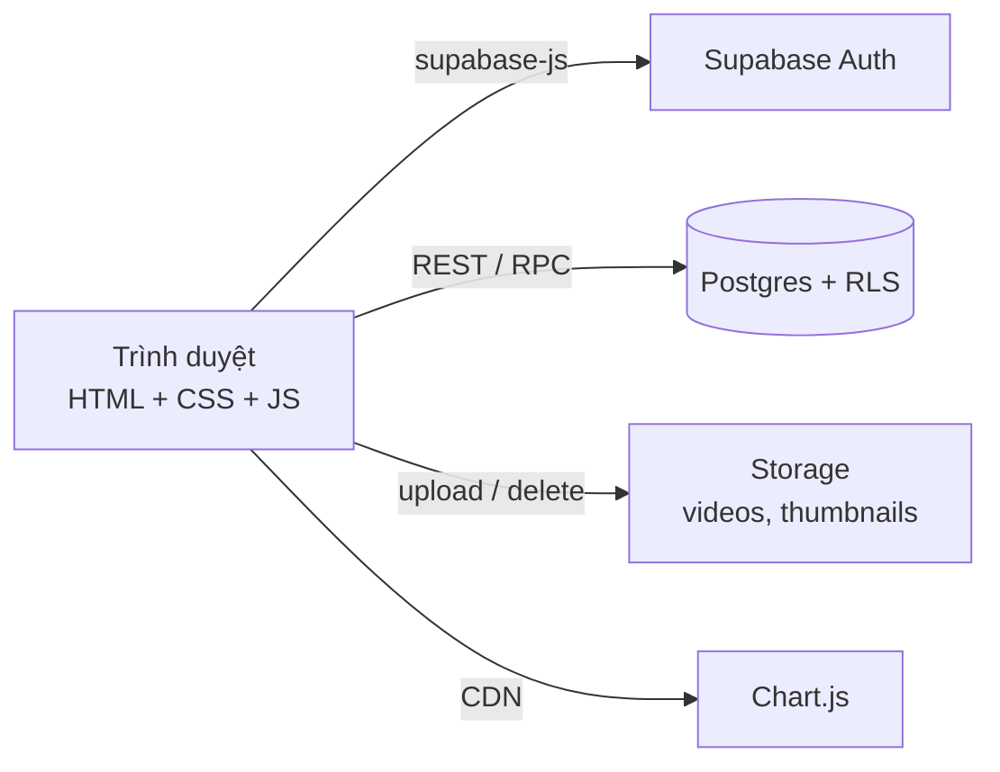
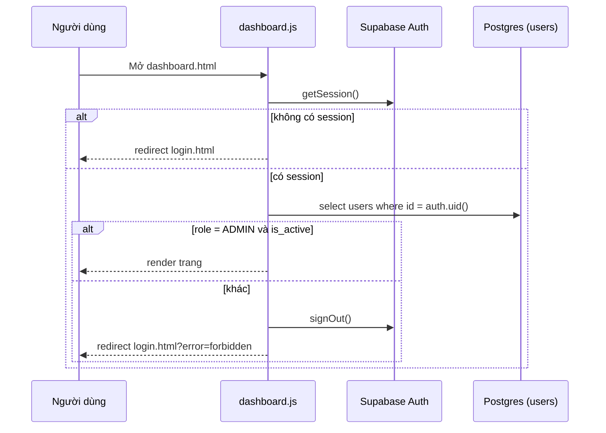

# ARCHITECTURE — Video Admin

## 1. Tổng quan



Không có server riêng. Trình duyệt gọi trực tiếp Supabase bằng khóa **anon/publishable**. Mọi quyền truy cập được ép bằng **RLS** và kiểm tra `is_admin()` trong RPC.

## 2. Cấu trúc thư mục

```
video-admin/
├─ index.html
├─ login.html · register.html · forgot-password.html · reset-password.html
├─ dashboard.html · videos.html · video-form.html
└─ assets/
   ├─ css/
   │  ├─ base.css         # biến màu, reset, typography
   │  ├─ layout.css       # sidebar, topbar, grid
   │  ├─ components.css   # button, input, table, card, modal, toast, badge
   │  └─ auth.css         # giao diện 4 trang xác thực
   └─ js/
      ├─ config.js        # SUPABASE_URL, SUPABASE_ANON_KEY
      ├─ supabaseClient.js
      ├─ auth.js          # requireAdmin(), redirectIfLoggedIn(), signOut()
      ├─ ui.js            # toast, confirm modal, render sidebar/topbar
      ├─ utils.js         # formatBytes, formatNumber, escapeHtml, debounce
      ├─ services/
      │  ├─ videoService.js
      │  ├─ categoryService.js
      │  ├─ dashboardService.js
      │  └─ storageService.js
      └─ pages/
         ├─ login.js · register.js · forgotPassword.js · resetPassword.js
         └─ dashboard.js · videos.js · videoForm.js
```

## 3. Trách nhiệm từng lớp

| Lớp | Được làm | Không được làm |
|---|---|---|
| `pages/*.js` | Gắn sự kiện, đọc form, gọi service, render DOM, hiện toast | Gọi `supabase.from(...)` trực tiếp |
| `services/*.js` | Gọi Supabase, ném lỗi (`throw`) khi có `error`, trả dữ liệu thô | Thao tác DOM |
| `auth.js` | Guard, đăng nhập, đăng xuất | Render giao diện |
| `ui.js` | Thành phần giao diện dùng chung | Gọi API |
| `utils.js` | Hàm thuần (pure), không phụ thuộc DOM/API | Có side effect |

## 4. Luồng bảo vệ trang (guard)



Guard chỉ để trải nghiệm tốt. Dù ai đó bỏ qua guard, RLS và RPC vẫn chặn dữ liệu.

## 5. Mẫu code nền tảng

### 5.1 `assets/js/config.js`
```js
// Lấy ở Supabase → Project Settings → API. Chỉ dùng khóa anon/publishable.
export const SUPABASE_URL = 'https://YOUR-PROJECT-REF.supabase.co';
export const SUPABASE_ANON_KEY = 'YOUR-ANON-OR-PUBLISHABLE-KEY';
```

### 5.2 `assets/js/supabaseClient.js`
```js
import { createClient } from 'https://esm.sh/@supabase/supabase-js@2';
import { SUPABASE_URL, SUPABASE_ANON_KEY } from './config.js';

export const supabase = createClient(SUPABASE_URL, SUPABASE_ANON_KEY);
```

### 5.3 `assets/js/auth.js` (guard)
```js
import { supabase } from './supabaseClient.js';

export async function requireAdmin() {
  const { data: { session } } = await supabase.auth.getSession();
  if (!session) {
    location.replace('login.html');
    return null;
  }
  const { data: profile, error } = await supabase
    .from('users')
    .select('id, username, email, role, is_active')
    .eq('id', session.user.id)
    .single();

  if (error || !profile || profile.role !== 'ADMIN' || !profile.is_active) {
    await supabase.auth.signOut();
    location.replace('login.html?error=forbidden');
    return null;
  }
  return profile;
}
```

### 5.4 `assets/js/services/videoService.js` (danh sách + phân trang)
```js
import { supabase } from '../supabaseClient.js';

export async function listVideos({ page = 1, pageSize = 10, search = '', categoryId = null,
                                   sortBy = 'created_at', ascending = false } = {}) {
  const from = (page - 1) * pageSize;
  const to = from + pageSize - 1;

  let query = supabase
    .from('videos')
    .select('id, title, thumbnail_url, views_count, status, category:video_categories(id, name)',
            { count: 'exact' })
    .order(sortBy, { ascending })
    .range(from, to);

  if (search) query = query.ilike('title', `%${search}%`);
  if (categoryId) query = query.eq('category_id', categoryId);

  const { data, error, count } = await query;
  if (error) throw error;
  return { rows: data, total: count };
}
```

### 5.5 `assets/js/services/dashboardService.js`
```js
import { supabase } from '../supabaseClient.js';

export async function getStats() {
  const { data, error } = await supabase.rpc('get_dashboard_stats');
  if (error) throw error;
  return data; // { total_videos, total_views, storage_bytes }
}

export async function getTopVideos(limit = 10) {
  const { data, error } = await supabase.rpc('get_top_videos', { p_limit: limit });
  if (error) throw error;
  return data; // [{ id, title, views_count }]
}

export async function getViewsSeries(granularity, from, to) {
  const { data, error } = await supabase.rpc('get_views_timeseries', {
    p_granularity: granularity, // 'day' | 'month'
    p_from: from,               // 'YYYY-MM-DD'
    p_to: to
  });
  if (error) throw error;
  return data; // [{ bucket_date, view_count }]
}
```

### 5.6 `assets/js/services/storageService.js`
```js
import { supabase } from '../supabaseClient.js';

export async function uploadFile(bucket, file, userId) {
  const ext = file.name.split('.').pop().toLowerCase();
  const path = `${userId}/${crypto.randomUUID()}.${ext}`;
  const { error } = await supabase.storage
    .from(bucket)
    .upload(path, file, { contentType: file.type, upsert: false });
  if (error) throw error;
  const { data } = supabase.storage.from(bucket).getPublicUrl(path);
  return { path, publicUrl: data.publicUrl, size: file.size };
}

export async function removeFiles(bucket, paths) {
  const list = paths.filter(Boolean);
  if (!list.length) return;
  const { error } = await supabase.storage.from(bucket).remove(list);
  if (error) throw error;
}
```
Lưu ý: `upload` của supabase-js không trả phần trăm tiến độ, nên UI dùng spinner. (Muốn có thanh tiến độ thật cần upload dạng resumable/TUS — thuộc phần mở rộng.)

### 5.7 `assets/js/utils.js`
```js
export function formatNumber(n) {
  return new Intl.NumberFormat('vi-VN').format(n ?? 0);
}

export function formatBytes(bytes) {
  if (!bytes) return '0 B';
  const units = ['B', 'KB', 'MB', 'GB', 'TB'];
  const i = Math.min(Math.floor(Math.log(bytes) / Math.log(1024)), units.length - 1);
  return `${(bytes / 1024 ** i).toFixed(i === 0 ? 0 : 1)} ${units[i]}`;
}

export function escapeHtml(str = '') {
  return String(str).replace(/[&<>"']/g, (c) => (
    { '&': '&amp;', '<': '&lt;', '>': '&gt;', '"': '&quot;', "'": '&#39;' }[c]
  ));
}

export function debounce(fn, delay = 300) {
  let timer;
  return (...args) => {
    clearTimeout(timer);
    timer = setTimeout(() => fn(...args), delay);
  };
}
```

### 5.8 Nạp script trong HTML
```html
<script src="https://cdn.jsdelivr.net/npm/chart.js@4"></script>
<script type="module" src="assets/js/pages/dashboard.js"></script>
```

## 6. Xử lý lỗi

- Service `throw` lỗi gốc. Page bắt bằng `try/catch`, ghi `console.error(err)` và hiện `toast` thân thiện.
- Ánh xạ lỗi thường gặp sang tiếng Việt:

| Tình huống | Thông báo |
|---|---|
| `Invalid login credentials` | Email hoặc mật khẩu không đúng |
| `User already registered` | Email đã được sử dụng |
| Lỗi RLS (`42501`) | Bạn không có quyền thực hiện thao tác này |
| Mất kết nối | Không kết nối được máy chủ, vui lòng thử lại |

## 7. Quy ước điều hướng

- Chưa đăng nhập → `login.html`.
- Đăng nhập là ADMIN → `dashboard.html`.
- Sidebar: Dashboard, Videos. Đăng xuất ở topbar.
- `index.html` kiểm tra session rồi chuyển hướng.
