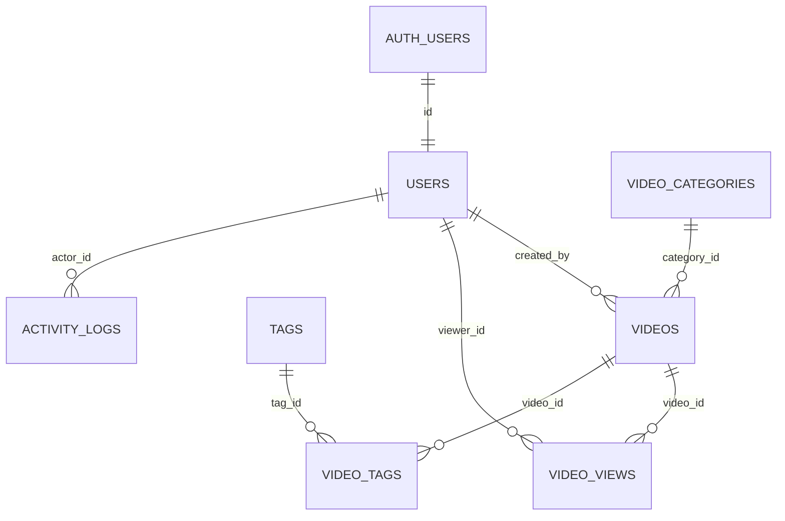

# DATABASE — Video Admin (Supabase / Postgres)

Tài liệu schema, SQL, RLS, Storage và RPC. Chạy các **Phần 1 → 6** theo thứ tự trong **Supabase → SQL Editor**. Phần 7 (seed) chạy sau khi đã tạo 2 tài khoản (xem `SETUP_SUPABASE.md`).

> Thứ tự quan trọng: bảng → hàm → trigger → RLS → Storage → quyền → seed. Chạy sai thứ tự sẽ báo lỗi "relation does not exist".

---

## 1. Sơ đồ quan hệ (ERD)



## 2. Từ điển dữ liệu

| Bảng | Mục đích |
|---|---|
| `users` | Hồ sơ người dùng, liên kết 1-1 với `auth.users`; chứa `username`, `role` |
| `video_categories` | Danh mục video |
| `videos` | Video (upload hoặc URL), thumbnail, lượt xem, dung lượng |
| `tags`, `video_tags` | Thẻ và quan hệ nhiều-nhiều với video |
| `video_views` | Mỗi dòng = 1 lượt xem, dùng cho biểu đồ theo ngày/tháng |
| `activity_logs` | Nhật ký thao tác của admin (mở rộng) |

### Bảng `videos`

| Cột | Kiểu | Ghi chú |
|---|---|---|
| id | bigint identity | Khóa chính, hiển thị ở List Video |
| title | text | 1–150 ký tự |
| description | text | Tùy chọn |
| category_id | bigint | FK → `video_categories`, `on delete set null` |
| source_type | text | `UPLOAD` hoặc `URL` |
| video_url | text | URL phát video (URL ngoài, hoặc public URL nếu upload) |
| video_path | text | Đường dẫn trong bucket `videos` (chỉ khi UPLOAD) |
| thumbnail_url / thumbnail_path | text | Tương tự cho bucket `thumbnails` |
| duration_seconds | integer | Tùy chọn |
| file_size_bytes / thumbnail_size_bytes | bigint | Dùng tính dung lượng storage |
| views_count | integer | Bộ đếm, cập nhật bằng trigger |
| status | text | `DRAFT`, `PUBLISHED`, `HIDDEN` |
| created_by | uuid | FK → `users` |
| created_at / updated_at | timestamptz | |

---

## PHẦN 1 — Bảng

```sql
-- ===== users (hồ sơ, liên kết auth.users) =====
create table public.users (
  id          uuid primary key references auth.users (id) on delete cascade,
  username    text not null,
  email       text not null,
  role        text not null default 'USER',
  avatar_url  text,
  is_active   boolean not null default true,
  created_at  timestamptz not null default now(),
  updated_at  timestamptz not null default now(),
  constraint users_role_check check (role in ('ADMIN', 'USER')),
  constraint users_username_format check (username ~ '^[A-Za-z0-9_]{3,30}$')
);
create unique index users_username_key on public.users (lower(username));
create unique index users_email_key on public.users (lower(email));

-- ===== video_categories =====
create table public.video_categories (
  id          bigint generated always as identity primary key,
  name        text not null,
  slug        text not null unique,
  description text,
  created_at  timestamptz not null default now(),
  constraint video_categories_name_len check (char_length(name) between 1 and 100)
);
create unique index video_categories_name_key on public.video_categories (lower(name));

-- ===== videos =====
create table public.videos (
  id                   bigint generated always as identity primary key,
  title                text not null,
  description          text,
  category_id          bigint references public.video_categories (id) on delete set null,
  source_type          text not null default 'URL',
  video_url            text,
  video_path           text,
  thumbnail_url        text,
  thumbnail_path       text,
  duration_seconds     integer check (duration_seconds is null or duration_seconds >= 0),
  file_size_bytes      bigint not null default 0 check (file_size_bytes >= 0),
  thumbnail_size_bytes bigint not null default 0 check (thumbnail_size_bytes >= 0),
  views_count          integer not null default 0 check (views_count >= 0),
  status               text not null default 'PUBLISHED',
  created_by           uuid references public.users (id) on delete set null,
  created_at           timestamptz not null default now(),
  updated_at           timestamptz not null default now(),
  constraint videos_title_len check (char_length(title) between 1 and 150),
  constraint videos_source_check check (source_type in ('UPLOAD', 'URL')),
  constraint videos_status_check check (status in ('DRAFT', 'PUBLISHED', 'HIDDEN')),
  constraint videos_source_fields check (
    (source_type = 'URL' and video_url is not null)
    or (source_type = 'UPLOAD' and video_path is not null)
  )
);
create index videos_created_at_idx  on public.videos (created_at desc);
create index videos_category_idx    on public.videos (category_id);
create index videos_views_count_idx on public.videos (views_count desc);
create index videos_status_idx      on public.videos (status);

-- ===== tags + video_tags =====
create table public.tags (
  id         bigint generated always as identity primary key,
  name       text not null,
  slug       text not null unique,
  created_at timestamptz not null default now()
);
create unique index tags_name_key on public.tags (lower(name));

create table public.video_tags (
  video_id bigint not null references public.videos (id) on delete cascade,
  tag_id   bigint not null references public.tags (id) on delete cascade,
  primary key (video_id, tag_id)
);

-- ===== video_views (mỗi dòng = 1 lượt xem) =====
create table public.video_views (
  id        bigint generated always as identity primary key,
  video_id  bigint not null references public.videos (id) on delete cascade,
  viewer_id uuid references public.users (id) on delete set null,
  viewed_at timestamptz not null default now()
);
create index video_views_video_idx     on public.video_views (video_id);
create index video_views_viewed_at_idx on public.video_views (viewed_at);

-- ===== activity_logs (nhật ký thao tác admin) =====
create table public.activity_logs (
  id         bigint generated always as identity primary key,
  actor_id   uuid references public.users (id) on delete set null,
  action     text not null,            -- ví dụ: VIDEO_CREATE, VIDEO_UPDATE, VIDEO_DELETE
  entity     text not null,            -- ví dụ: videos
  entity_id  text,
  metadata   jsonb not null default '{}'::jsonb,
  created_at timestamptz not null default now()
);
create index activity_logs_created_at_idx on public.activity_logs (created_at desc);
```

---

## PHẦN 2 — Hàm và trigger

```sql
-- ===== Kiểm tra admin (dùng trong RLS và RPC) =====
create or replace function public.is_admin()
returns boolean
language sql
stable
security definer
set search_path = public
as $$
  select exists (
    select 1 from public.users u
    where u.id = auth.uid() and u.role = 'ADMIN' and u.is_active
  );
$$;

-- ===== Tự cập nhật updated_at =====
create or replace function public.set_updated_at()
returns trigger
language plpgsql
as $$
begin
  new.updated_at = now();
  return new;
end;
$$;

-- ===== Chặn user thường tự đổi role / is_active =====
-- auth.uid() là null khi chạy trong SQL Editor, nên seed/quản trị bằng SQL vẫn hoạt động.
create or replace function public.protect_user_columns()
returns trigger
language plpgsql
security definer
set search_path = public
as $$
begin
  if auth.uid() is not null
     and not public.is_admin()
     and (new.role is distinct from old.role
          or new.is_active is distinct from old.is_active) then
    raise exception 'Not allowed to change role or status' using errcode = '42501';
  end if;
  new.updated_at = now();
  return new;
end;
$$;

-- ===== Tạo hồ sơ khi có user mới trong auth.users =====
-- Role luôn là USER. Muốn ADMIN phải do admin/SQL cấp sau.
create or replace function public.handle_new_user()
returns trigger
language plpgsql
security definer
set search_path = public
as $$
begin
  insert into public.users (id, username, email, role)
  values (
    new.id,
    coalesce(
      nullif(new.raw_user_meta_data ->> 'username', ''),
      left(regexp_replace(split_part(new.email, '@', 1), '[^A-Za-z0-9_]', '_', 'g'), 30)
    ),
    new.email,
    'USER'
  );
  return new;
end;
$$;

-- ===== Tăng views_count khi có lượt xem mới =====
create or replace function public.increment_video_views()
returns trigger
language plpgsql
security definer
set search_path = public
as $$
begin
  update public.videos set views_count = views_count + 1 where id = new.video_id;
  return new;
end;
$$;

-- ===== Triggers =====
create trigger on_auth_user_created
  after insert on auth.users
  for each row execute function public.handle_new_user();

create trigger trg_users_protect
  before update on public.users
  for each row execute function public.protect_user_columns();

-- Chỉ chạy khi các cột nội dung bị sửa (không chạy khi trigger tăng views_count)
create trigger trg_videos_updated_at
  before update of title, description, category_id, source_type, video_url, video_path,
                   thumbnail_url, thumbnail_path, duration_seconds,
                   file_size_bytes, thumbnail_size_bytes, status
  on public.videos
  for each row execute function public.set_updated_at();

create trigger trg_video_views_increment
  after insert on public.video_views
  for each row execute function public.increment_video_views();
```

---

## PHẦN 3 — RPC (hàm gọi từ frontend)

```sql
-- ===== Kiểm tra username còn trống (cho trang Register, gọi được khi chưa đăng nhập) =====
create or replace function public.is_username_available(p_username text)
returns boolean
language sql
stable
security definer
set search_path = public
as $$
  select not exists (select 1 from public.users where lower(username) = lower(p_username));
$$;

-- ===== Ghi 1 lượt xem (dành cho trình phát công khai sau này) =====
create or replace function public.track_view(p_video_id bigint)
returns void
language plpgsql
security definer
set search_path = public
as $$
begin
  if not exists (select 1 from public.videos where id = p_video_id and status = 'PUBLISHED') then
    raise exception 'video not found';
  end if;
  insert into public.video_views (video_id, viewer_id) values (p_video_id, auth.uid());
end;
$$;

-- ===== Dashboard: 3 thẻ số liệu =====
create or replace function public.get_dashboard_stats()
returns json
language plpgsql
stable
security definer
set search_path = public
as $$
begin
  if not public.is_admin() then
    raise exception 'forbidden' using errcode = '42501';
  end if;

  return (
    select json_build_object(
      'total_videos',  count(*),
      'total_views',   coalesce(sum(views_count), 0),
      'storage_bytes', coalesce(sum(file_size_bytes + thumbnail_size_bytes), 0)
    )
    from public.videos
  );
end;
$$;

-- ===== Dashboard: top video nhiều lượt xem =====
create or replace function public.get_top_videos(p_limit integer default 10)
returns table (id bigint, title text, views_count integer)
language plpgsql
stable
security definer
set search_path = public
as $$
begin
  if not public.is_admin() then
    raise exception 'forbidden' using errcode = '42501';
  end if;

  return query
    select v.id, v.title, v.views_count
    from public.videos v
    order by v.views_count desc, v.id asc
    limit greatest(p_limit, 1);
end;
$$;

-- ===== Dashboard: lượt xem theo ngày/tháng (múi giờ Việt Nam) =====
create or replace function public.get_views_timeseries(
  p_granularity text,   -- 'day' hoặc 'month'
  p_from date,
  p_to date
)
returns table (bucket_date date, view_count bigint)
language plpgsql
stable
security definer
set search_path = public
as $$
begin
  if not public.is_admin() then
    raise exception 'forbidden' using errcode = '42501';
  end if;
  if p_granularity not in ('day', 'month') then
    raise exception 'p_granularity must be day or month';
  end if;

  return query
    select s.bucket::date, count(vv.id)
    from generate_series(
           date_trunc(p_granularity, p_from::timestamp),
           date_trunc(p_granularity, p_to::timestamp),
           ('1 ' || p_granularity)::interval
         ) as s(bucket)
    left join public.video_views vv
      on date_trunc(p_granularity, vv.viewed_at at time zone 'Asia/Ho_Chi_Minh') = s.bucket
    group by s.bucket
    order by s.bucket;
end;
$$;
```

---

## PHẦN 4 — Row Level Security (RLS)

```sql
alter table public.users            enable row level security;
alter table public.video_categories enable row level security;
alter table public.videos           enable row level security;
alter table public.tags             enable row level security;
alter table public.video_tags       enable row level security;
alter table public.video_views      enable row level security;
alter table public.activity_logs    enable row level security;

-- ===== users =====
-- Không có policy INSERT/DELETE: hồ sơ do trigger tạo; khóa user dùng is_active.
create policy users_select on public.users
  for select to authenticated
  using (id = auth.uid() or public.is_admin());

create policy users_update_self on public.users
  for update to authenticated
  using (id = auth.uid())
  with check (id = auth.uid());

create policy users_update_admin on public.users
  for update to authenticated
  using (public.is_admin())
  with check (public.is_admin());

-- ===== video_categories =====
create policy categories_read on public.video_categories
  for select to anon, authenticated using (true);
create policy categories_admin_write on public.video_categories
  for all to authenticated
  using (public.is_admin()) with check (public.is_admin());

-- ===== tags =====
create policy tags_read on public.tags
  for select to anon, authenticated using (true);
create policy tags_admin_write on public.tags
  for all to authenticated
  using (public.is_admin()) with check (public.is_admin());

-- ===== videos =====
create policy videos_read on public.videos
  for select to anon, authenticated
  using (status = 'PUBLISHED' or public.is_admin());
create policy videos_admin_write on public.videos
  for all to authenticated
  using (public.is_admin()) with check (public.is_admin());

-- ===== video_tags =====
create policy video_tags_read on public.video_tags
  for select to anon, authenticated using (true);
create policy video_tags_admin_write on public.video_tags
  for all to authenticated
  using (public.is_admin()) with check (public.is_admin());

-- ===== video_views: chỉ admin đọc; ghi qua RPC track_view =====
create policy video_views_admin_read on public.video_views
  for select to authenticated using (public.is_admin());

-- ===== activity_logs =====
create policy logs_admin_read on public.activity_logs
  for select to authenticated using (public.is_admin());
create policy logs_admin_insert on public.activity_logs
  for insert to authenticated
  with check (public.is_admin() and actor_id = auth.uid());
```

---

## PHẦN 5 — Storage

```sql
-- Giới hạn 50 MB/video khớp giới hạn mặc định của gói Free
insert into storage.buckets (id, name, public, file_size_limit, allowed_mime_types)
values
  ('videos',     'videos',     true, 52428800, array['video/mp4', 'video/webm', 'video/quicktime']),
  ('thumbnails', 'thumbnails', true, 5242880,  array['image/jpeg', 'image/png', 'image/webp'])
on conflict (id) do nothing;

create policy "storage_public_read" on storage.objects
  for select using (bucket_id in ('videos', 'thumbnails'));

create policy "storage_admin_insert" on storage.objects
  for insert to authenticated
  with check (bucket_id in ('videos', 'thumbnails') and public.is_admin());

create policy "storage_admin_update" on storage.objects
  for update to authenticated
  using (bucket_id in ('videos', 'thumbnails') and public.is_admin())
  with check (bucket_id in ('videos', 'thumbnails') and public.is_admin());

create policy "storage_admin_delete" on storage.objects
  for delete to authenticated
  using (bucket_id in ('videos', 'thumbnails') and public.is_admin());
```

Quy ước đường dẫn file: `<user_id>/<uuid>.<ext>` (ví dụ `3f2a.../9c1b....mp4`).

---

## PHẦN 6 — Phân quyền (GRANT)

Một số project Supabase mới không tự cấp quyền cho Data API, nên cấp tường minh. Quyền chỉ là "cửa vào"; **RLS vẫn là lớp quyết định** ai được đọc/ghi dòng nào.

```sql
grant usage on schema public to anon, authenticated;

grant select, update                 on public.users            to authenticated;
grant select                         on public.video_categories to anon, authenticated;
grant insert, update, delete         on public.video_categories to authenticated;
grant select                         on public.tags             to anon, authenticated;
grant insert, update, delete         on public.tags             to authenticated;
grant select                         on public.videos           to anon, authenticated;
grant insert, update, delete         on public.videos           to authenticated;
grant select                         on public.video_tags       to anon, authenticated;
grant insert, update, delete         on public.video_tags       to authenticated;
grant select                         on public.video_views      to authenticated;
grant select, insert                 on public.activity_logs    to authenticated;

grant usage, select on all sequences in schema public to authenticated;

-- RPC chỉ dành cho admin: bỏ quyền của anon, chỉ giữ cho người đã đăng nhập
-- (bên trong hàm vẫn kiểm tra is_admin()).
revoke execute on function public.get_dashboard_stats()                      from public, anon;
revoke execute on function public.get_top_videos(integer)                    from public, anon;
revoke execute on function public.get_views_timeseries(text, date, date)     from public, anon;
grant  execute on function public.get_dashboard_stats()                      to authenticated;
grant  execute on function public.get_top_videos(integer)                    to authenticated;
grant  execute on function public.get_views_timeseries(text, date, date)     to authenticated;

-- RPC công khai
grant execute on function public.is_username_available(text) to anon, authenticated;
grant execute on function public.track_view(bigint)          to anon, authenticated;
```

Lưu ý: **không** thu hồi quyền `execute` của `is_admin()`, vì các policy RLS gọi hàm này dưới quyền `anon`/`authenticated`.

---

## PHẦN 7 — Seed dữ liệu (chạy sau khi đã tạo 2 tài khoản)

```sql
-- 7.1 Cấp quyền ADMIN cho admin1 (user1 giữ role USER mặc định)
update public.users set role = 'ADMIN' where email = 'admin1@gmail.com';

-- 7.2 Danh mục và tag
insert into public.video_categories (name, slug, description) values
  ('Giải trí',  'giai-tri',  'Video giải trí'),
  ('Giáo dục',  'giao-duc',  'Video học tập, hướng dẫn'),
  ('Âm nhạc',   'am-nhac',   'Video ca nhạc'),
  ('Thể thao',  'the-thao',  'Video thể thao'),
  ('Công nghệ', 'cong-nghe', 'Video công nghệ');

insert into public.tags (name, slug) values
  ('hot', 'hot'), ('mới', 'moi'), ('hướng dẫn', 'huong-dan'),
  ('review', 'review'), ('trực tiếp', 'truc-tiep'), ('ngắn', 'ngan');

-- 7.3 12 video demo (nguồn URL, không tốn dung lượng Storage)
insert into public.videos
  (title, description, thumbnail_url, video_url, source_type, category_id,
   status, created_by, duration_seconds, created_at)
select
  'Video demo ' || g,
  'Mô tả cho video demo số ' || g,
  'https://picsum.photos/seed/video' || g || '/320/180',
  'https://commondatastorage.googleapis.com/gtv-videos-bucket/sample/BigBuckBunny.mp4',
  'URL',
  (select id from public.video_categories order by id offset (g % 5) limit 1),
  'PUBLISHED',
  (select id from public.users where email = 'admin1@gmail.com'),
  60 + g * 7,
  now() - (g || ' days')::interval
from generate_series(1, 12) as g;

-- 7.4 Lượt xem ngẫu nhiên trong 90 ngày (mỗi video số lượng khác nhau để biểu đồ top 10 có hình dạng)
-- Trigger sẽ tự cộng views_count.
insert into public.video_views (video_id, viewed_at)
select v.id, now() - (random() * interval '90 days')
from public.videos v
cross join lateral generate_series(1, 20 + ((v.id * 37) % 180)::int) as n;
```

Muốn thử dung lượng storage mà không cần upload thật, cập nhật tạm: 
```sql
update public.videos set file_size_bytes = 25 * 1024 * 1024 where id in (1, 2, 3);
```

---

## 8. Câu lệnh kiểm tra nhanh (chạy trong SQL Editor)

```sql
select id, username, email, role, is_active from public.users;       -- có admin1 (ADMIN) và user1 (USER)
select count(*) as videos from public.videos;                         -- 12 nếu đã seed
select sum(views_count) as tong_view, (select count(*) from public.video_views) as so_dong_view
from public.videos;                                                   -- hai số phải bằng nhau
select schemaname, tablename, rowsecurity from pg_tables
where schemaname = 'public';                                          -- rowsecurity = true cho mọi bảng
```

Ghi chú: các RPC `get_dashboard_stats`, `get_top_videos`, `get_views_timeseries` kiểm tra `auth.uid()`, nên **gọi trong SQL Editor sẽ báo `forbidden`**. Hãy kiểm tra chúng qua ứng dụng (đăng nhập admin1).

## 9. Làm lại từ đầu (chỉ khi muốn xóa sạch, sẽ mất toàn bộ dữ liệu)

```sql
drop trigger if exists on_auth_user_created on auth.users;
drop policy if exists storage_public_read  on storage.objects;
drop policy if exists storage_admin_insert on storage.objects;
drop policy if exists storage_admin_update on storage.objects;
drop policy if exists storage_admin_delete on storage.objects;
drop table if exists public.activity_logs, public.video_views, public.video_tags,
                     public.tags, public.videos, public.video_categories, public.users cascade;
drop function if exists public.get_views_timeseries(text, date, date);
drop function if exists public.get_top_videos(integer);
drop function if exists public.get_dashboard_stats();
drop function if exists public.track_view(bigint);
drop function if exists public.is_username_available(text);
drop function if exists public.increment_video_views();
drop function if exists public.handle_new_user();
drop function if exists public.protect_user_columns();
drop function if exists public.set_updated_at();
drop function if exists public.is_admin();
-- Xóa file trong Storage bằng giao diện Storage trước khi xóa bucket.
```

## 10. Quy tắc thay đổi schema

1. Sửa SQL trong file này trước, rồi mới chạy trên Supabase.
2. Mỗi thay đổi ghi một dòng vào bảng nhật ký dưới đây.

| Ngày | Thay đổi | Người thực hiện |
|---|---|---|
| 2026-10-04 | Khởi tạo schema v1 | — |
